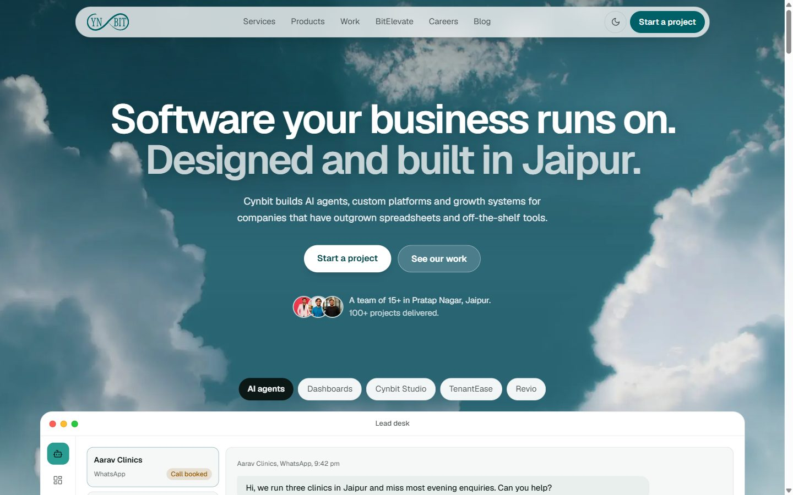

# Cynbit website rebuild



**Live:** https://cynbit.vercel.app

A working prototype of a faster, clearer cynbit.in homepage and a hardened contact form backend.
Built for the Cynbit Full Stack Developer Intern assessment.

## What's in it

89 pages, with all content migrated from the live site:

| Route | What it does |
|---|---|
| `/` | Homepage: live sky hero, a product window that steps through AI agents, dashboards, Cynbit Studio, TenantEase and Revio, then services, work, team, process, BitElevate and FAQ |
| `/services`, `/products`, `/case-studies`, `/careers`, `/blog` | Section pages |
| `/case-studies/[slug]`, `/careers/[slug]`, `/blog/[slug]` | 13 case studies, 20 job pages (each with a six-field application form) and 25 articles |
| `/story`, `/team`, `/impact`, `/bitelevate`, `/bitelevate/paths` | Company and programme pages |
| `/diaries`, `/diaries/[slug]` | Student diaries: index plus 8 stories |
| `/privacy`, `/terms`, `/cookies` | Legal pages, text unchanged from the live site |
| `/contact` | Project enquiry form: server-side validation, honeypot, rate limit, database, optional email alert |
| `/opengraph-image`, `/robots.txt`, `/sitemap.xml` | Generated from code |

Only BitElevate enrolment still goes to the live site, because that is where enrolment and payment happen.

## Run it locally

Requires Node 20 or newer.

```bash
npm install
npm run dev        # http://localhost:3000
npm test           # validation and rate-limit tests
npm run build && npm start
```

With no environment variables set, enquiries are stored in `leads.db` (SQLite) in the project folder.
To read them:

```bash
node -e "const {createClient}=require('@libsql/client');createClient({url:'file:leads.db'}).execute('select * from leads').then(r=>console.table(r.rows))"
```

## Deploying

Copy `.env.example` to `.env.local` (or set the variables in Vercel):

- `SITE_URL`: the public URL.
- `DATABASE_URL` and `DATABASE_AUTH_TOKEN`: a Turso/libSQL database. Required on Vercel, whose filesystem is read-only. The same code runs against the local file and the hosted database.
- `RESEND_API_KEY`, `LEADS_INBOX`, `LEADS_FROM`: optional email alert for each new lead. The lead is saved before the email is sent, so a failed email never loses it.

## Results

Lighthouse 12.8, mobile preset (simulated mid-range phone on throttled 4G), 31 Oct 2026. Both sites were
measured over the internet: the original at www.cynbit.in and the rebuild at https://cynbit.vercel.app.

| Page | Performance | Accessibility | Best practices | SEO | First paint | Largest paint | Blocking time | Page weight |
|---|---|---|---|---|---|---|---|---|
| Original home | 56 | 82 | 100 | 100 | 9.5 s | 11.4 s | 0 ms | 1,685 KB |
| **Rebuilt home** | **95** | **100** | 100 | 100 | 1.4 s | 2.4 s | 20 ms | 287 KB |
| Original contact | 56 | 86 | 100 | 100 | 9.1 s | 11.0 s | 0 ms | 1,680 KB |
| **Rebuilt contact** | **98** | **100** | 100 | 100 | 0.9 s | 1.8 s | 20 ms | 200 KB |
| Rebuilt services | 99 | 100 | 100 | 100 | 1.0 s | 2.1 s | 60 ms | 204 KB |
| Rebuilt job page | 97 | 100 | 100 | 100 | 0.9 s | 2.0 s | 180 ms | 209 KB |
| Rebuilt article | 93 | 100 | 100 | 100 | 1.2 s | 2.7 s | 200 ms | 340 KB |
| Rebuilt case study | 99 | 100 | 100 | 100 | 0.9 s | 2.3 s | 60 ms | 277 KB |
| Rebuilt diaries | 96 | 100 | 100 | 100 | 0.9 s | 2.2 s | 40 ms | 217 KB |
| Rebuilt privacy | 98 | 100 | 100 | 100 | 0.9 s | 1.8 s | 60 ms | 201 KB |
| Rebuilt career paths | 96 | 100 | 100 | 100 | 1.2 s | 2.4 s | 60 ms | 250 KB |

The original was measured on the home and contact pages only. Scores move a few points between runs.

What changed, in order of impact: the 1.1 MB icon font became inline SVG icons; content is rendered visible
instead of waiting for scroll animations to run; the five product mock-ups are rendered on the server so they
add no client JavaScript; pages are pre-rendered as static HTML; and the live sky behind the hero only starts
after the visitor's first interaction.

## Stack

Next.js 15 (App Router, server actions), React 19, TypeScript, Tailwind CSS 4, lucide-react for icons,
zod for validation, libSQL for storage.

Motion is CSS only: a one-off hero entrance, scroll-linked reveals (`animation-timeline: view()`) and small
responses to clicks and hovers. Content is visible without JavaScript, browsers without scroll timelines
simply show the finished page, and everything is switched off under `prefers-reduced-motion`.

Type is Geist (SIL Open Font License) for text and JetBrains Mono for code, both self-hosted by `next/font`.
Light theme by default; the moon button in the header switches to dark and remembers the choice.
